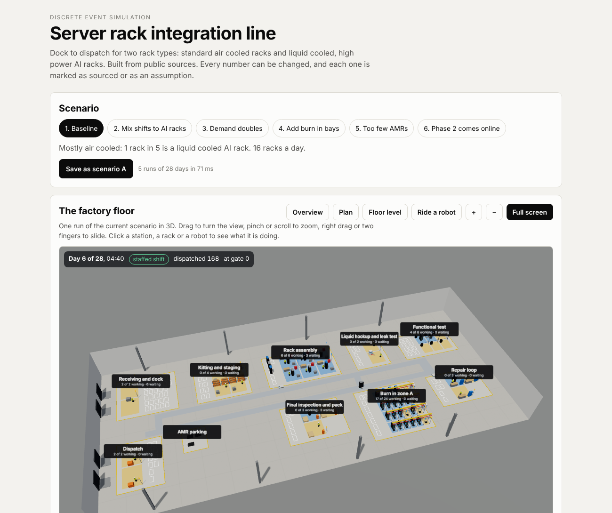

# Rack line simulation

A discrete event simulation of a server rack integration line, from dock to dispatch, with a 3D factory floor you can rearrange. Built from public sources.

Live page: https://coffinlindsey-hub.github.io/rack-line-simulation/



## What it is

A single web page that simulates a factory line where servers, network gear and empty racks arrive, are assembled into finished racks, tested, burned in and shipped. It handles two rack types: standard air cooled racks, and liquid cooled, high power AI racks.

The line plays out on a 3D floor. You can turn and zoom the view, move through time, click any station, rack or robot to see what it is doing, add or remove work positions, and drag stations to a new place. Robot travel time comes from the floor, so a layout change shows up in the results.

It is a learning tool for questions about throughput, bottlenecks, buffers, takt time and material flow. It is not a model of any real factory.

## How the model works

- The engine keeps a list of future events (a delivery arrives, a station finishes a rack, a shift ends, a machine breaks) and jumps from one to the next.
- Stations in order: receiving, kitting, rack assembly (manual stations, automated cells, or both), liquid cooling hookup and leak test (AI racks only), functional test, burn in, final inspection and pack, dispatch. Racks that fail leak test, functional test or burn in go to a repair loop and repeat the test.
- Buffers between stations are finite. A station is blocked when the next buffer is full and starved when it has nothing to work on.
- Every station has a footprint and a place on the floor. Robots are routed around the equipment on a 1 metre grid.
- Every move between stations needs a robot from a shared AMR fleet. The nearest idle robot is sent. Travel time is the routed distance divided by speed, plus time to pick up and set down.
- Burn in is limited three ways: bays, electrical power per zone, and liquid cooling per zone. A rack only starts if all three have room.
- Manual stations follow shifts. Test, burn in and AMRs run around the clock.
- A second phase (more bays and stations) can come online partway through a run. Until then it is drawn as a building site.
- Times are drawn from distributions: triangular for manual work, lognormal for test and repair, exponential for time between breakdowns.
- Each scenario runs several times with different random seeds after a warm up period. Results are shown as an average with the lowest and highest run.
- The page shows a hand calculation of each station's capacity next to the simulated result, and explains the gap.
- A material flow table lists rack moves per day between each pair of stations, the distance, and total robot travel.

## Scenarios included

1. Baseline: mostly air cooled, 16 racks a day
2. The mix shifts to mostly liquid cooled AI racks
3. Demand doubles
4. Burn in bays are added until burn in is no longer the constraint
5. Too few AMRs on that busy line
6. Phase 2 comes online partway through the run

Any scenario, with or without a changed layout, can be saved and compared side by side with another.

## What is sourced and what is assumed

Every parameter is on the page with its default, unit and a tag. Nothing comes from any company's internal data.

### Values taken from public sources

| Value | Default | Source |
|---|---|---|
| Value of an AI rack | 3,000,000 $ | [Fierce Electronics, Blackwell platform coverage (2024)](https://www.fierceelectronics.com/ai/blackwell-platform-puts-jensen-higher-realm-cost-and-energy) |
| Pressure hold, shortest | 30 min | [RDP, commissioning a liquid cooled AI rack (2026)](https://rdp.in/gpu-mart/?p=12732) |
| Pressure hold, longest | 60 min | [RDP, commissioning a liquid cooled AI rack (2026)](https://rdp.in/gpu-mart/?p=12732) |
| Power draw, standard rack | 11 kW | [Data Center Knowledge on the Uptime Institute 2026 Global Data Center Survey](https://www.datacenterknowledge.com/ai-data-centers/ai-drives-data-center-uncertainty-in-uptime-s-2026-survey) |
| Power draw, AI rack | 130 kW | [Supermicro, NVIDIA GB200 NVL72 datasheet](https://www.supermicro.com/datasheet/datasheet_SuperCluster_GB200_NVL72.pdf), [HPE QuickSpecs, NVIDIA GB200 NVL72 by HPE](https://www.hpe.com/il/en/collaterals/collateral.a50009224enw.html) |

Burn in times (24 h for a standard rack, 48 h for an AI rack) are assumptions chosen inside published ranges: 4 to 12 hours for typical acceptance, 72 hours minimum at one integrator, 3 to 7 days for GPU clusters.

### Assumptions

These have no public figure behind them. They are placeholders chosen to be plausible, and all can be changed on the page.

- **Demand and mix.** demand (also the target) 16 racks/day; share of liquid cooled ai racks 0.2 fraction; material per delivery 8 racks worth; delivery timing variation 40 +/- %; value of a standard rack 250,000 $
- **Shifts.** staffed hours per day 16 h; working days per week 7 days
- **Receiving and dock.** inbound dock doors 2 doors; unload and receive, fastest 20 min/rack; unload and receive, typical 30 min/rack; unload and receive, slowest 50 min/rack; dock yard space 32 racks worth
- **Kitting and staging.** kitting stations 4 stations; kit one rack, fastest 40 min; kit one rack, typical 60 min; kit one rack, slowest 90 min; ai rack time multiplier 1.3 x; buffer before kitting 8 racks
- **Rack assembly.** manual stations 6 stations; automated cells 0 cells; manual assembly, fastest 150 min; manual assembly, typical 210 min; manual assembly, slowest 300 min; ai rack time multiplier 1.6 x; automated cell time vs manual 0.6 x; manual station mtbf 200 h; manual station mttr 0.5 h; automated cell mtbf 40 h; automated cell mttr 1.5 h; buffer before assembly 6 racks
- **Liquid hookup and leak test.** leak test stations 2 stations; hookup, fastest 45 min; hookup, typical 60 min; hookup, slowest 90 min; leak test first pass yield 0.95 fraction; buffer before leak test 3 racks
- **Functional test.** test positions 6 positions; test time, standard rack (mean) 3 h; test time, ai rack (mean) 6 h; test time spread 0.3 cv; first pass yield, standard rack 0.92 fraction; first pass yield, ai rack 0.85 fraction; test position mtbf 150 h; test position mttr 2 h; buffer before test 6 racks
- **Burn in.** zone a bays 24 bays; zone a power capacity 2,000 kW; zone a liquid cooling capacity 1,500 kW; burn in time, standard rack 24 h; burn in time, ai rack 48 h; connect and disconnect 30 min; first pass yield, standard rack 0.97 fraction; first pass yield, ai rack 0.93 fraction; buffer before burn in 8 racks
- **Repair loop.** repair benches 3 benches; repair time (mean) 4 h; repair time spread 0.6 cv; buffer before repair 6 racks
- **Final inspection and pack.** pack stations 3 stations; inspect and pack, fastest 60 min; inspect and pack, typical 90 min; inspect and pack, slowest 150 min; ai rack time multiplier 1.3 x; buffer before pack 6 racks
- **Dispatch.** outbound dock doors 2 doors; load one rack, fastest 15 min; load one rack, typical 20 min; load one rack, slowest 40 min; finished goods staging 10 racks
- **AMRs.** amr fleet size 3 robots; speed carrying a rack 0.6 m/s; speed when empty 1.2 m/s; pick up or set down, fastest 1 min; pick up or set down, typical 2 min; pick up or set down, slowest 4 min; component cart trips per rack 3 trips
- **Phase 2.** zone b burn in bays 0 bays; zone b power capacity 2,000 kW; zone b liquid cooling capacity 1,500 kW; extra manual assembly stations 0 stations; extra automated cells 0 cells; extra test positions 0 positions; extra pack stations 0 stations
- **Floor.** Size of one work position, by station: receiving and dock 5 x 6 m; kitting and staging 4.5 x 4.5 m; rack assembly 5 x 5 m; liquid hookup and leak test 4.5 x 5 m; functional test 3.2 x 4 m; burn in zone a 1.8 x 3.6 m; burn in zone b 1.8 x 3.6 m; repair loop 4.5 x 4.5 m; final inspection and pack 5 x 5 m; dispatch 5 x 6 m; amr parking 2 x 2.4 m. Buffer slots are 1.3 x 1.9 m. Gaps between stations are 5 m, the main aisle is 8 m. The building is drawn to fit the stations.

### Sources

- [Supermicro, NVIDIA GB200 NVL72 datasheet](https://www.supermicro.com/datasheet/datasheet_SuperCluster_GB200_NVL72.pdf). Power shelves total 132 kW; operating power 125 to 135 kW.
- [HPE QuickSpecs, NVIDIA GB200 NVL72 by HPE](https://www.hpe.com/il/en/collaterals/collateral.a50009224enw.html). Rack thermal design power 132 kW; about 3,245 lb fully loaded.
- [Fierce Electronics, Blackwell platform coverage (2024)](https://www.fierceelectronics.com/ai/blackwell-platform-puts-jensen-higher-realm-cost-and-energy). A GB200 NVL72 rack is a 120 kW system weighing about 3,000 lb; an analyst priced it at up to $3 million. The vendor has not published a price.
- [Data Center Knowledge on the Uptime Institute 2026 Global Data Center Survey](https://www.datacenterknowledge.com/ai-data-centers/ai-drives-data-center-uncertainty-in-uptime-s-2026-survey). Most commonly reported rack density reached 11 kW; the average excluding sites built for more than 30 kW is 7.8 kW.
- [Microway, rackmount server product page](https://www.microway.com/products/rackmount-servers/intel-xeon-servers/). Each system is burn in tested for a minimum of 72 hours before shipment.
- [GSE, server burn in test before production](https://www.gse.kz/en/blog/server-burn-in-test-before-production). For typical acceptance, 4 to 12 hours is often enough.
- [RDP, GPU cluster burn in guide (2026)](https://rdp.in/gpu-mart/?p=12729). For GPU clusters, 3 to 7 days of continuous load is the working norm; under 24 hours is a smoke test.
- [RDP, commissioning a liquid cooled AI rack (2026)](https://rdp.in/gpu-mart/?p=12732). Dry pressure decay test held typically 30 to 60 minutes with no measurable drop, before any fluid, then a wet leak inspection.
- [Omron HD-1500 autonomous mobile robot](https://robotics.omron.com/products/mobile-robots/hd-series/hd-1500/). Maximum payload 1,500 kg; maximum speed 1.8 m/s.
- [OTTO 1500 spec sheet (Rockwell Automation)](https://cdn.sanity.io/files/armc7p5y/production/e40f30bcd48679644351b1bcbe483f0462f1b803.pdf). Maximum capacity 1,900 kg; maximum speed 2.0 m/s.
- [Gigabyte glossary, server manufacturing levels](https://www.gigabyte.com/glossary/server-manufacturing-levels). L10 is a complete server, L11 is rack scale integration, L12 is multi rack and cluster integration. L11 can include manifolds, CDUs and leak detection, then validation of flow, pressure, power and cooling.
- [Supermicro, rack integration services](https://www.supermicro.com/en/solutions/rack-integration). Published stages: assembly (node assembly, rack and stack, networking and power, cabling and labeling), burn in and testing (full rack burn in, test report), delivery (labeling, crating, air ride trucking).
- [Supermicro press release, rack scale capacity (2023)](https://www.supermicro.com/en/pressreleases/supermicro-expands-global-manufacturing-footprint-increasing-worldwide-rack-scale). Stated worldwide capacity of 5,000 racks per month across several plants, for racks up to 100 kW.

## What it does not model

- AMR traffic. Robots never queue behind or block each other, and aisle width is not checked.
- AMR charging and AMR breakdowns.
- Moves inside a station, such as from its buffer to a work position.
- Part shortages. Material always arrives complete.
- Operators as a separate resource, skills, breaks or learning curves.
- More than two rack types, changeovers or engineering holds.
- Scrap. Every rack is eventually repaired and shipped.
- Cluster level testing across racks, firmware loading as its own step, or customer acceptance.
- Cost, other than the value of work in progress.
- Real equipment. The shapes in the 3D view are simple stand ins.

It is much simpler than commercial tools such as FlexSim or Plant Simulation. Those work from real CAD layouts and measured data, model traffic, people and conveyors in detail, and are validated against running lines.

## Run it

Open `index.html` in a browser. There is no build step and nothing to install.

Tests for the engine and the layout use only what ships with Node:

```
node --test tests/sim.test.js
```

## Files

- `sim.js`: the simulation engine and the hand calculation.
- `layout.js`: station footprints, default floor plan, and robot routing.
- `params.js`: every parameter with its default, unit, tag and source, plus the scenarios.
- `scene3d.js`: the 3D view.
- `app.js`, `index.html`, `style.css`: the page.
- `tests/sim.test.js`: tests, for example that throughput never exceeds the theoretical bottleneck, that no rack is lost, and that robot routes stay off the equipment.
- `vendor/three.min.js`: three.js r159, the only library, used for 3D drawing. MIT license, included in `vendor/`.
